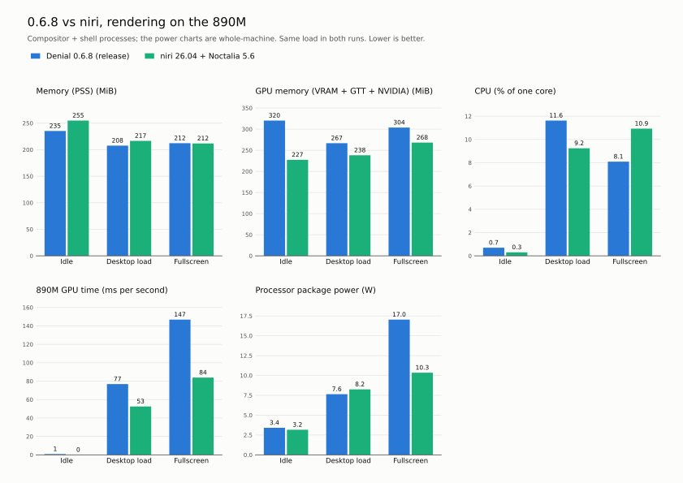
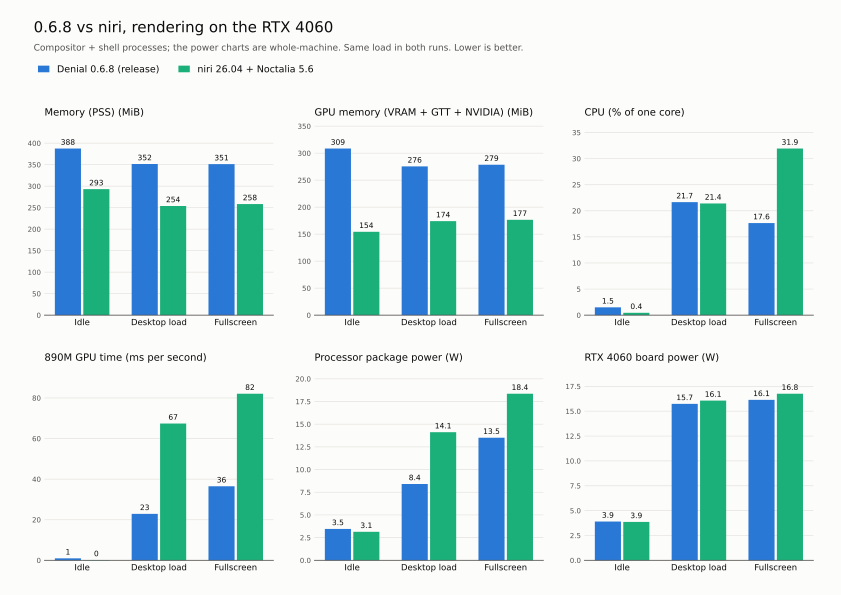
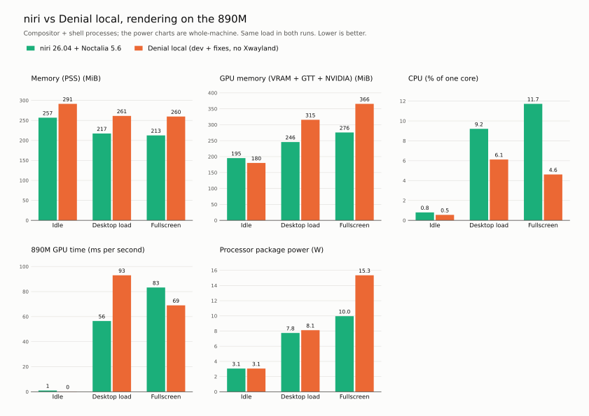
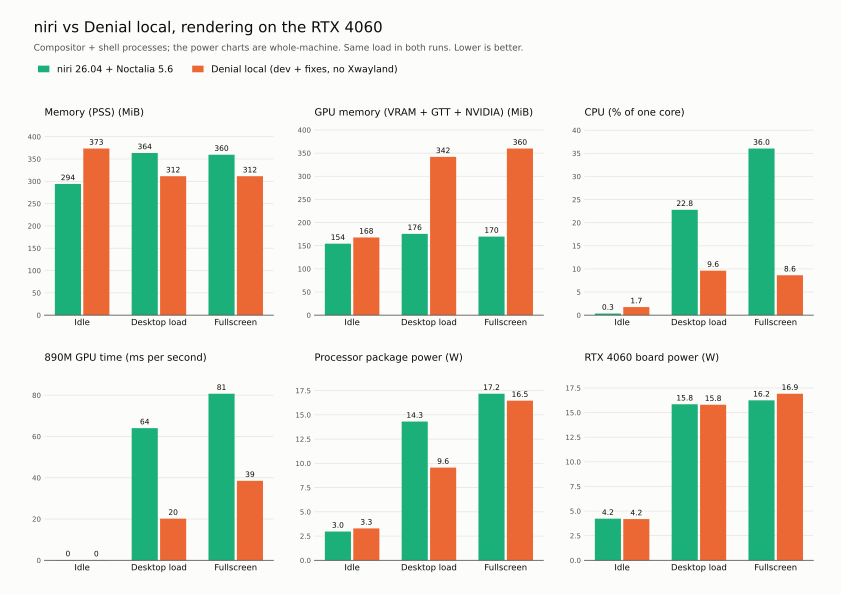
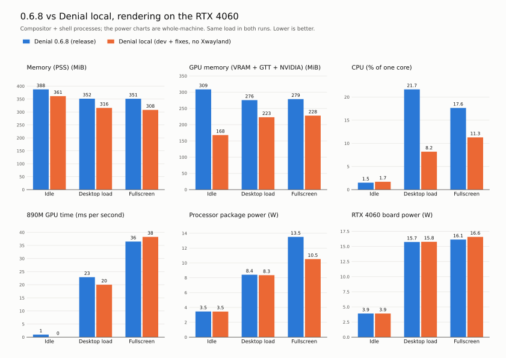

# Denial vs niri + Noctalia on both GPUs (2026-11-23)

Three setups on one laptop, each rendering once on the GPU that drives the
panel and once on the discrete GPU, under the same scripted load:

| Setup | What ran |
|---|---|
| Denial 0.6.8 (release) | The published `denial`, `denial-flutter-engine` and `denial-plugin-manager` 0.6.8 Arch packages, their own shell bundle, default GLES composition, Xwayland. |
| Denial local | `deniald` 44bf236f… built from `dev` 094a5dc2 plus the uncommitted working tree (opaque-region covers, damage-limited cross-GPU copy), without Xwayland (`cargo build --no-default-features --features flutter`); the engine from the Flutter fork bfac097493d and the shell AOT the workstation runs; `--vulkan-composer` with `DENIAL_VULKAN_SHELL=1`. |
| niri 26.04 + Noctalia 5.6 | niri with Noctalia as its shell (bar, wallpaper, panels), started by `niri-session`, no X11 support. |

All charts and tables in one file: [comparison.pdf](comparison.pdf): the table of all six runs, then one page per pair and GPU.

## Machine and load

- Lab host `.18`: Ryzen AI laptop on AC power. The Radeon 890M drives the
  1920×1200 panel at 144 Hz, scale 1. The RTX 4060 has no outputs.
- **On the 890M:** Denial `DENIAL_RENDER_DEVICE=…65:00.0-render`, niri
  `debug { render-drm-device "/dev/dri/renderD129" }`. Every client pinned to
  the 890M (`__EGL_VENDOR_LIBRARY_FILENAMES` = Mesa, `DRI_PRIME`,
  `MESA_VK_DEVICE_SELECT`).
- **On the RTX 4060:** Denial `DENIAL_RENDER_DEVICE=…64:00.0-render`, niri
  `render-drm-device "/dev/dri/renderD128"`. Clients left on the GPU the
  compositor's dma-buf feedback names (`PIN=0`). Each compositor still opens
  the 890M to put frames on the panel.
- **Idle:** the session alone, 20 s window.
- **Desktop load:** mpvpaper playing a looping 1920×1200 30 fps H.264 video as
  wallpaper (VA-API decode), Chromium playing a 1280×720 60 fps video in a
  window, kitty running `top -d 1`. 30 s window after 12 s warm-up.
- **Fullscreen:** the desktop load plus a Chromium kiosk page that redraws the
  whole screen every frame (a stand-in for a game). 30 s window after 10 s
  warm-up. The page held 144 fps in all six runs.
- niri on the RTX 4060 ran its desktop and fullscreen phases with 20 s
  windows; every other phase window is as above.
- A uinput Left Shift tap every 20 s keeps the screen on.

"Compositor + shell" is `deniald` for Denial, whose shell runs inside the
compositor process, and `niri` + `noctalia` for niri. Denial 0.6.8 also starts
Xwayland (53–119 MiB PSS, under 0.1% CPU), listed in the breakdown below and
left out of the charts.

Measured per run:

| Metric | Source |
|---|---|
| Memory (PSS) | `smaps_rollup` of the compositor + shell processes |
| GPU memory | VRAM + GTT from DRM fdinfo (890M), plus the RTX 4060 framebuffer memory from `nvidia-smi pmon -s m` |
| CPU | user + kernel time of the compositor + shell processes |
| 890M GPU time | engine time from DRM fdinfo; the RTX 4060 driver reports none per process |
| Processor package power | RAPL package energy over the window: CPU cores and 890M, every client included |
| RTX 4060 board power | `nvidia-smi` `power.draw` every 500 ms; not measured in the 890M runs of 0.6.8 and niri, which ran before this sampling was added. In the 890M run of Denial local the unused card drew 4.2 W. |

## Results

### Denial 0.6.8 vs niri





### niri vs Denial local





### Denial 0.6.8 vs Denial local




### All six runs

MiB, % of one core, ms of 890M GPU time per second, W; n/m = not measured.

#### Idle

| Run | PSS MiB | GPU mem MiB | CPU % | 890M ms/s | Package W | 4060 W |
|---|---:|---:|---:|---:|---:|---:|
| 0.6.8 on 890M | 230 | 232 | 0.6 | 1 | 3.1 | n/m |
| 0.6.8 on RTX 4060 | 379 | 308 | 1.9 | 1 | 3.3 | 4.2 |
| Denial local on 890M | 291 | 180 | 0.5 | 0 | 3.1 | 4.2 |
| Denial local on RTX 4060 | 373 | 168 | 1.7 | 0 | 3.3 | 4.2 |
| niri on 890M | 257 | 195 | 0.8 | 1 | 3.1 | n/m |
| niri on RTX 4060 | 294 | 154 | 0.3 | 0 | 3.0 | 4.2 |

#### Desktop load

| Run | PSS MiB | GPU mem MiB | CPU % | 890M ms/s | Package W | 4060 W |
|---|---:|---:|---:|---:|---:|---:|
| 0.6.8 on 890M | 213 | 315 | 12.8 | 92 | 9.0 | n/m |
| 0.6.8 on RTX 4060 | 351 | 313 | 18.2 | 21 | 8.5 | 15.7 |
| Denial local on 890M | 261 | 315 | 6.1 | 93 | 8.1 | 4.2 |
| Denial local on RTX 4060 | 312 | 342 | 9.6 | 20 | 9.6 | 15.8 |
| niri on 890M | 217 | 246 | 9.2 | 56 | 7.8 | n/m |
| niri on RTX 4060 | 364 | 176 | 22.8 | 64 | 14.3 | 15.8 |

#### Fullscreen

| Run | PSS MiB | GPU mem MiB | CPU % | 890M ms/s | Package W | 4060 W |
|---|---:|---:|---:|---:|---:|---:|
| 0.6.8 on 890M | 211 | 334 | 10.6 | 164 | 17.7 | n/m |
| 0.6.8 on RTX 4060 | 354 | 311 | 16.0 | 37 | 16.5 | 17.1 |
| Denial local on 890M | 260 | 366 | 4.6 | 69 | 15.3 | 4.2 |
| Denial local on RTX 4060 | 312 | 360 | 8.6 | 39 | 16.5 | 16.9 |
| niri on 890M | 213 | 276 | 11.7 | 83 | 10.0 | n/m |
| niri on RTX 4060 | 360 | 170 | 36.0 | 81 | 17.2 | 16.2 |

## What the numbers say

- **On the 890M,** Denial local uses the least CPU of the three (6.1% / 4.6%
  of a core, desktop / fullscreen, against 9.2% / 11.7% for niri and
  12.8% / 10.6% for 0.6.8). niri uses the least compositor GPU time on the
  desktop (56 against 93 ms/s) and the least package power (7.8 / 10.0 W
  against 8.1 / 15.3 W for Denial local). In the fullscreen phase the 890M
  as a whole was busier under Denial local than under niri (17% against 15%,
  16 against 11 W from its power sensor) while the GPU time the clients and
  the compositor report adds up to less (259 against 294 ms/s); what spends
  the difference was not measured.
- **On the RTX 4060,** each compositor copies its frames to the 890M. Denial
  (both versions) copies on the GPUs: a Vulkan copy on the RTX 4060 into a
  linear buffer the 890M samples, then a draw into the scanout buffer. niri
  reads frames back through the CPU: a profile of its fullscreen phase shows
  22% of its samples in `clock_gettime` called from the NVIDIA driver while it
  waits and about 15% in glibc's `memcpy` family. niri's CPU goes from
  9.2% / 11.7% to 22.8% / 36.0%; Denial local's from 6.1% / 4.6% to
  9.6% / 8.6%.
- **Denial local against 0.6.8:** about half the CPU on both GPUs, and
  fullscreen 890M GPU time 164 → 69 ms/s, because a client that declares an
  opaque region now hides what is under it. On the RTX 4060 the copy follows
  the frame's damage instead of the whole screen. PSS is 48–61 MiB higher on the
  890M and 6–42 MiB lower on the RTX 4060.
- **Rendering on the RTX 4060 costs more for every setup on this load:** under
  load the card draws 15.7–17.1 W against 4.2 W unused, and PSS grows by
  37–149 MiB, in both file-backed and anonymous pages.

## Memory per process

(MiB. `anon` and `file` are the PSS parts; RSS counts shared pages whole;
NVIDIA is RTX 4060 framebuffer memory.)

| Run | Phase | Process | PSS | anon | file | RSS | VRAM | GTT | NVIDIA |
|---|---|---|---:|---:|---:|---:|---:|---:|---:|
| 0.6.8 on 890M | Idle | deniald | 230 | 131 | 99 | 283 | 210 | 22 | 0 |
| 0.6.8 on 890M | Idle | Xwayland | 72 | 26 | 46 | 119 | 13 | 10 | 0 |
| 0.6.8 on 890M | Desktop load | deniald | 213 | 136 | 78 | 288 | 188 | 127 | 0 |
| 0.6.8 on 890M | Desktop load | Xwayland | 55 | 26 | 29 | 119 | 13 | 10 | 0 |
| 0.6.8 on 890M | Fullscreen | deniald | 211 | 136 | 75 | 288 | 178 | 155 | 0 |
| 0.6.8 on 890M | Fullscreen | Xwayland | 53 | 26 | 27 | 119 | 13 | 10 | 0 |
| 0.6.8 on RTX 4060 | Idle | deniald | 379 | 181 | 198 | 425 | 37 | 32 | 238 |
| 0.6.8 on RTX 4060 | Idle | Xwayland | 119 | 70 | 48 | 158 | 0 | 0 | 2 |
| 0.6.8 on RTX 4060 | Desktop load | deniald | 351 | 184 | 167 | 429 | 37 | 32 | 243 |
| 0.6.8 on RTX 4060 | Desktop load | Xwayland | 99 | 70 | 28 | 158 | 0 | 0 | 2 |
| 0.6.8 on RTX 4060 | Fullscreen | deniald | 354 | 191 | 163 | 438 | 37 | 34 | 239 |
| 0.6.8 on RTX 4060 | Fullscreen | Xwayland | 96 | 70 | 26 | 158 | 0 | 0 | 2 |
| Denial local on 890M | Idle | deniald | 291 | 135 | 157 | 307 | 160 | 18 | 2 |
| Denial local on 890M | Desktop load | deniald | 261 | 147 | 114 | 319 | 173 | 141 | 2 |
| Denial local on 890M | Fullscreen | deniald | 260 | 149 | 111 | 321 | 150 | 214 | 2 |
| Denial local on RTX 4060 | Idle | deniald | 373 | 193 | 180 | 389 | 47 | 41 | 80 |
| Denial local on RTX 4060 | Desktop load | deniald | 312 | 190 | 122 | 387 | 47 | 41 | 254 |
| Denial local on RTX 4060 | Fullscreen | deniald | 312 | 197 | 115 | 394 | 47 | 43 | 270 |
| niri on 890M | Idle | niri | 110 | 38 | 72 | 168 | 78 | 11 | 2 |
| niri on 890M | Idle | noctalia | 146 | 61 | 85 | 215 | 90 | 14 | 0 |
| niri on 890M | Desktop load | niri | 93 | 39 | 53 | 169 | 99 | 42 | 2 |
| niri on 890M | Desktop load | noctalia | 125 | 59 | 66 | 213 | 90 | 12 | 0 |
| niri on 890M | Fullscreen | niri | 90 | 39 | 51 | 169 | 100 | 72 | 2 |
| niri on 890M | Fullscreen | noctalia | 122 | 59 | 63 | 213 | 90 | 12 | 0 |
| niri on RTX 4060 | Idle | niri | 149 | 43 | 105 | 196 | 41 | 10 | 42 |
| niri on RTX 4060 | Idle | noctalia | 145 | 54 | 92 | 203 | 0 | 0 | 61 |
| niri on RTX 4060 | Desktop load | niri | 178 | 47 | 130 | 250 | 56 | 25 | 33 |
| niri on RTX 4060 | Desktop load | noctalia | 186 | 112 | 74 | 271 | 0 | 0 | 62 |
| niri on RTX 4060 | Fullscreen | niri | 180 | 49 | 131 | 255 | 49 | 19 | 40 |
| niri on RTX 4060 | Fullscreen | noctalia | 180 | 109 | 71 | 268 | 0 | 0 | 62 |

PSS splits shared pages between the processes that map them, so the file part
drops once Chromium and mpvpaper map the same libraries (Mesa, LLVM, glibc).
That is why most runs read lower under load than idle. DRM fdinfo counts every
buffer object a client holds, including client buffers it imported, so part
of the growth under load is the clients' own frames. Noctalia holds 90 MiB of
890M VRAM in every phase on the 890M (its wallpaper is a 3840×2160 texture).

## Repeatability

Earlier the same day, the desktop and fullscreen phases ran twice for niri on
the 890M and twice for an older Denial lab build (`db85c90b`, Vulkan, before
occlusion culling). Repeats agreed within a few percent: niri 8.4–9.4% CPU and
53–56 ms/s on the desktop, 9.8–10.8% and 84–88 ms/s fullscreen.

## Run it again

On the test machine, with `bench.sh`, `phases.sh`, `switch.sh`, `video.html`,
`full.html`, `keepawake.py`, `../compositor_load.py` and
`../compositor_memory.py` in `~/.cache/bench`, the two videos made with

```sh
ffmpeg -nostdin -f lavfi -i "testsrc2=s=1920x1200:r=30:d=30" -c:v libx264 -preset fast -b:v 8M -pix_fmt yuv420p ~/.cache/bench/wall.mp4
ffmpeg -nostdin -f lavfi -i "testsrc2=s=1280x720:r=60:d=30" -c:v libx264 -preset fast -b:v 6M -pix_fmt yuv420p ~/.cache/bench/clip.mp4
```

and the session under test running:

```sh
PIN=1 ~/.cache/bench/phases.sh SETUP-amd      # rendering on the 890M
PIN=0 ~/.cache/bench/phases.sh SETUP-nvidia   # rendering on the RTX 4060
```

[phases.sh](phases.sh) starts the keep-awake helper and runs the three phases
with [bench.sh](bench.sh). [switch.sh](switch.sh) `amd|nvidia` installs the
local build from `~/.cache/denial/lab/bench-local` on the chosen render GPU
and restarts greetd. Results land in `~/.cache/bench/results`. Copy them to
`results/` here and run `python3 make_charts.py` (matplotlib): it writes
`charts/*.svg`, `comparison.pdf` and the tables above.

Notes for `.18`:
- The installed `denial-session` must pass `--vulkan-composer` when
  `DENIAL_VULKAN_COMPOSER=1` (dev's `packaging/arch/denial-session` does; the
  0.6.8 one does not, so 0.6.8 composes with GLES).
- Noctalia 5.6 needs libjxl 0.13; on a host with an older libjxl, run it with
  that library alone on `LD_LIBRARY_PATH`.
- niri runs as a user service: stop `niri.service` before restarting greetd,
  or the next session refuses to start.
