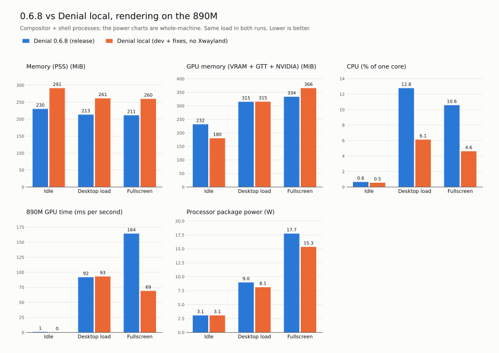

# Denial vs niri + Noctalia on both GPUs (2026-11-23)

Three setups on one laptop, each rendering once on the GPU that drives the
panel and once on the discrete GPU, under the same scripted load:

| Setup | What ran |
|---|---|
| Denial 0.6.8 (release) | The published `denial`, `denial-flutter-engine` and `denial-plugin-manager` 0.6.8 Arch packages, their own shell bundle, default GLES composition, Xwayland. |
| Denial local | `deniald` c943a9d6… built from `dev` 473977f2 (opaque-region covers, damage-limited cross-GPU copy) plus the uncommitted pacing of hidden clients described below, without Xwayland (`cargo build --no-default-features --features flutter`); the engine from the Flutter fork bfac097493d and the shell AOT the workstation runs; `--vulkan-composer` with `DENIAL_VULKAN_SHELL=1`. |
| niri 26.04 + Noctalia 5.6 | niri with Noctalia as its shell (bar, wallpaper, panels), started by `niri-session`, no X11 support. |

All charts and tables in one file: [comparison.pdf](comparison.pdf): the table of all six runs, then one page per pair and GPU.

## Machine and load

- Lab host `.18`: Ryzen AI laptop on AC power. The Radeon 890M drives the
  1920×1200 panel at 144 Hz, scale 1. The RTX 4060 has no outputs.
- **On the 890M:** Denial `DENIAL_RENDER_DEVICE=…65:00.0-render`, niri
  `debug { render-drm-device "/dev/dri/renderD129" }`. Every client pinned to
  the 890M (`__EGL_VENDOR_LIBRARY_FILENAMES` = Mesa, `DRI_PRIME`,
  `MESA_VK_DEVICE_SELECT`).
- **On the RTX 4060:** Denial `DENIAL_RENDER_DEVICE=…64:00.0-render`, niri
  `render-drm-device "/dev/dri/renderD128"`. Clients left on the GPU the
  compositor's dma-buf feedback names (`PIN=0`). Each compositor still opens
  the 890M to put frames on the panel.
- **Idle:** the session alone, 20 s window.
- **Desktop load:** mpvpaper playing a looping 1920×1200 30 fps H.264 video as
  wallpaper (VA-API decode), Chromium playing a 1280×720 60 fps video in a
  window, kitty running `top -d 1`. 30 s window after 12 s warm-up.
- **Fullscreen:** the desktop load plus a Chromium kiosk page that redraws the
  whole screen every frame (a stand-in for a game). 30 s window after 10 s
  warm-up. The page held 144 fps in all six runs.
- A uinput Left Shift tap every 20 s keeps the screen on.
- Blur behind see-through windows in both compositors. kitty draws its
  background at 40% opacity (`background_opacity 0.4` in the host's
  `kitty.conf`); Chromium declares no opaque region, so either compositor
  must assume it may be see-through anywhere. Denial ran in its Blur
  transparency mode (`"transparencyMode": "blur"`, sigma 14), which blurs
  what lies under every window without a full opaque region, other windows
  included, and under its taskbar. niri got a window rule for every window,
  `background-effect { blur true; xray false; }` (`xray false` blurs what is
  under the window, not only the wallpaper), with niri's default blur
  settings (3 passes, offset 3); Noctalia asks niri for blur behind its bar
  itself. Denial's default Glass mode (refraction, rim light) is not compared.
- The same windows in both compositors, floating: Chromium's video window
  1070×660 with its top-left corner at (48,48) of the output, kitty 700×450
  at (96,96), the kiosk page filling the 1920×1200 output. Denial ran with its
  Stacking layout (`"windowLayout": "stacking"`), which places new windows
  48 px apart from the top-left corner; niri got window rules that open the
  two apps floating at the same sizes and spots ([niri-bench.sh](niri-bench.sh)).
  niri's own window list confirms them (`results/windows-*.json`); for Denial
  its render audit does. kitty redraws and declares its whole window changed
  on every `top` refresh, so its size matters to the compositor's work.

"Compositor + shell" is `deniald` for Denial, whose shell runs inside the
compositor process, and `niri` + `noctalia` for niri. Denial 0.6.8 also starts
Xwayland (53–119 MiB PSS, under 0.1% CPU), listed in the breakdown below and
left out of the charts.

Measured per run:

| Metric | Source |
|---|---|
| Memory (PSS) | `smaps_rollup` of the compositor + shell processes |
| GPU memory | VRAM + GTT from DRM fdinfo (890M), plus the RTX 4060 framebuffer memory from `nvidia-smi pmon -s m` |
| CPU | user + kernel time of the compositor + shell processes |
| 890M GPU time | engine time from DRM fdinfo; the RTX 4060 driver reports none per process |
| Processor package power | RAPL package energy over the window: CPU cores and 890M, every client included |
| RTX 4060 board power | `nvidia-smi` `power.draw` every 500 ms, in every run; the card draws 3.8–4.1 W when nothing renders on it. |

## Results

### Denial 0.6.8 vs niri


### niri vs Denial local


### Denial 0.6.8 vs Denial local




### All six runs

MiB, % of one core, ms of 890M GPU time per second, W.

#### Idle

| Run | PSS MiB | GPU mem MiB | CPU % | 890M ms/s | Package W | 4060 W |
|---|---:|---:|---:|---:|---:|---:|
| 0.6.8 on 890M | 235 | 320 | 0.7 | 1 | 3.4 | 4.0 |
| 0.6.8 on RTX 4060 | 388 | 309 | 1.5 | 1 | 3.5 | 3.9 |
| Denial local on 890M | 325 | 179 | 0.5 | 0 | 3.3 | 3.9 |
| Denial local on RTX 4060 | 361 | 168 | 1.7 | 0 | 3.5 | 3.9 |
| niri on 890M | 255 | 227 | 0.3 | 0 | 3.2 | 3.9 |
| niri on RTX 4060 | 293 | 154 | 0.4 | 0 | 3.1 | 3.9 |

#### Desktop load

| Run | PSS MiB | GPU mem MiB | CPU % | 890M ms/s | Package W | 4060 W |
|---|---:|---:|---:|---:|---:|---:|
| 0.6.8 on 890M | 208 | 267 | 11.6 | 77 | 7.6 | 4.0 |
| 0.6.8 on RTX 4060 | 352 | 276 | 21.7 | 23 | 8.4 | 15.7 |
| Denial local on 890M | 266 | 335 | 6.5 | 80 | 7.9 | 4.0 |
| Denial local on RTX 4060 | 316 | 223 | 8.2 | 20 | 8.3 | 15.8 |
| niri on 890M | 217 | 238 | 9.2 | 53 | 8.2 | 4.0 |
| niri on RTX 4060 | 254 | 174 | 21.4 | 67 | 14.1 | 16.1 |

#### Fullscreen

| Run | PSS MiB | GPU mem MiB | CPU % | 890M ms/s | Package W | 4060 W |
|---|---:|---:|---:|---:|---:|---:|
| 0.6.8 on 890M | 212 | 304 | 8.1 | 147 | 17.0 | 4.1 |
| 0.6.8 on RTX 4060 | 351 | 279 | 17.6 | 36 | 13.5 | 16.1 |
| Denial local on 890M | 260 | 362 | 5.7 | 73 | 11.8 | 4.0 |
| Denial local on RTX 4060 | 308 | 228 | 11.3 | 38 | 10.5 | 16.6 |
| niri on 890M | 212 | 268 | 10.9 | 84 | 10.3 | 4.0 |
| niri on RTX 4060 | 258 | 177 | 31.9 | 82 | 18.4 | 16.8 |

## What the numbers say

- **On the 890M,** Denial local uses the least CPU of the three (6.5% / 5.7%
  of a core, desktop / fullscreen, against 9.2% / 10.9% for niri and
  11.6% / 8.1% for 0.6.8). niri uses less compositor GPU time on the desktop
  (53 against 80 ms/s); in fullscreen Denial local uses less (73 against
  84 ms/s). Package power is within run-to-run spread of each other: 7.9
  against 8.2 W on the desktop, 11.8 against 10.3 W in fullscreen (see
  Repeatability). Summed over every client and the compositor, the fullscreen
  phase under Denial local used 39% of a core and 230 ms/s of GPU time, under
  niri 49% and 274 ms/s.
- **On the RTX 4060,** each compositor copies its frames to the 890M. Denial
  (both versions) copies on the GPUs: a Vulkan copy on the RTX 4060 into a
  linear buffer the 890M samples, then a draw into the scanout buffer. niri
  reads frames back through the CPU: a profile of its fullscreen phase shows
  22% of its samples in `clock_gettime` called from the NVIDIA driver while it
  waits and about 15% in glibc's `memcpy` family. niri's CPU goes to
  21.4% / 31.9% and package power to 14.1 / 18.4 W, against 8.2% / 11.3% and
  8.3 / 10.5 W for Denial local.
- **Denial local against 0.6.8:** about half the CPU on the desktop and two
  thirds of it in fullscreen, fullscreen 890M GPU time
  147 → 73 ms/s because a client that declares an opaque region hides what is
  under it, and fullscreen package power 17.0 → 11.8 W on the 890M and
  13.5 → 10.5 W on the RTX 4060, mostly from pacing the clients nothing shows
  (next section). On the RTX 4060 the copy follows the frame's damage instead
  of the whole screen. PSS is 48–90 MiB higher on the 890M and 27–43 MiB lower
  on the RTX 4060.
- **Rendering on the RTX 4060 costs more for every setup on this load:** the
  card draws 15.7–16.8 W under load against 3.9–4.1 W unused.

## Clients nothing shows

In the fullscreen phase the kiosk page covers the Chromium video window,
kitty and the video wallpaper. niri sends a window it cannot see no frame
callback per refresh, so those clients stop drawing. Denial 0.6.8 and Denial
before this change kept sending one per refresh: the hidden Chromium went on
compositing its 60 fps video, with about 20% of a core and 39 ms/s of GPU
time, and the package drew about 3–5 W more than with that window closed.
Closing the hidden clients one by one in fullscreen on the 890M:

| Package W | Denial, every refresh | niri |
|---|---:|---:|
| Every client | 14.6 | 10.1 |
| Without the hidden video window | 9.8 | 11.2 |
| Without kitty too | 8.6 | 10.8 |
| The kiosk page alone | 7.8 | 9.1 |

The composer already leaves out what an opaque draw above hides. It now
reports, for each output frame it draws, which client textures it left out
whole (a merged window's image counts for its root surface). A window or
layer surface with at least one surface left out and none shown on any
output gets its frame callbacks once a second instead of once per refresh,
and every refresh again as soon as a frame shows it. The hidden Chromium got
10 frame callbacks in 10 s instead of 600, the hidden wallpaper player dropped
from about 100 to about 45 ms/s of GPU time. Four fullscreen runs each before
and after on the 890M: 14.2, 15.7, 12.9, 12.2 W before, 9.4, 9.5, 12.7, 11.4 W
after.

## The desktop gap

On the 890M desktop Denial local drew about 80 frames a second at about
1.0 ms of GPU each, niri 91 at about 0.57 ms. The video wallpaper redraws the
whole screen every frame, and the shell painted the whole screen three times
under it: the root background color, the wallpaper's fill color and a black
box for the output the live wallpaper covers. None of it ever showed. The
shell now paints the wallpaper and its fill only on outputs no client covers,
and nothing at all under a covering client: the frame is cleared to black
there. Old and new shell alternated twice on the same session (desktop load,
890M):

| | Old shell | New shell |
|---|---:|---:|
| deniald GPU time | 76–85 ms/s | 59–69 ms/s |
| Composer frame | 877–977 µs | 760–785 µs |
| Composer draws | 463–524 µs | 292–298 µs |

The charts above predate this change. Most of what is left is the frosted
backdrop under the Chromium window: under Denial, Chromium declares no opaque
region, so its window gets a backdrop it fully covers.

## Memory per process

(MiB. `anon` and `file` are the PSS parts; RSS counts shared pages whole;
NVIDIA is RTX 4060 framebuffer memory.)

| Run | Phase | Process | PSS | anon | file | RSS | VRAM | GTT | NVIDIA |
|---|---|---|---:|---:|---:|---:|---:|---:|---:|
| 0.6.8 on 890M | Idle | deniald | 235 | 139 | 97 | 290 | 298 | 22 | 0 |
| 0.6.8 on 890M | Idle | Xwayland | 71 | 26 | 45 | 119 | 13 | 10 | 0 |
| 0.6.8 on 890M | Desktop load | deniald | 208 | 132 | 76 | 283 | 203 | 64 | 0 |
| 0.6.8 on 890M | Desktop load | Xwayland | 55 | 26 | 29 | 119 | 13 | 10 | 0 |
| 0.6.8 on 890M | Fullscreen | deniald | 212 | 139 | 74 | 290 | 184 | 120 | 0 |
| 0.6.8 on 890M | Fullscreen | Xwayland | 53 | 26 | 27 | 119 | 13 | 10 | 0 |
| 0.6.8 on RTX 4060 | Idle | deniald | 388 | 189 | 198 | 431 | 37 | 32 | 239 |
| 0.6.8 on RTX 4060 | Idle | Xwayland | 118 | 69 | 48 | 157 | 0 | 0 | 2 |
| 0.6.8 on RTX 4060 | Desktop load | deniald | 352 | 187 | 165 | 429 | 37 | 32 | 206 |
| 0.6.8 on RTX 4060 | Desktop load | Xwayland | 98 | 70 | 28 | 157 | 0 | 0 | 2 |
| 0.6.8 on RTX 4060 | Fullscreen | deniald | 351 | 192 | 159 | 435 | 37 | 34 | 207 |
| 0.6.8 on RTX 4060 | Fullscreen | Xwayland | 95 | 70 | 26 | 157 | 0 | 0 | 2 |
| Denial local on 890M | Idle | deniald | 325 | 169 | 156 | 341 | 160 | 17 | 2 |
| Denial local on 890M | Desktop load | deniald | 266 | 151 | 115 | 323 | 208 | 125 | 2 |
| Denial local on 890M | Fullscreen | deniald | 260 | 149 | 111 | 321 | 204 | 156 | 2 |
| Denial local on RTX 4060 | Idle | deniald | 361 | 181 | 180 | 376 | 47 | 41 | 80 |
| Denial local on RTX 4060 | Desktop load | deniald | 316 | 194 | 122 | 391 | 47 | 41 | 135 |
| Denial local on RTX 4060 | Fullscreen | deniald | 308 | 193 | 115 | 390 | 47 | 43 | 138 |
| niri on 890M | Idle | niri | 111 | 38 | 73 | 168 | 78 | 11 | 2 |
| niri on 890M | Idle | noctalia | 144 | 61 | 84 | 212 | 122 | 14 | 0 |
| niri on 890M | Desktop load | niri | 93 | 39 | 54 | 170 | 94 | 40 | 2 |
| niri on 890M | Desktop load | noctalia | 124 | 60 | 64 | 212 | 90 | 12 | 0 |
| niri on 890M | Fullscreen | niri | 91 | 39 | 51 | 170 | 94 | 70 | 2 |
| niri on 890M | Fullscreen | noctalia | 121 | 60 | 61 | 212 | 90 | 12 | 0 |
| niri on RTX 4060 | Idle | niri | 147 | 42 | 105 | 195 | 41 | 10 | 42 |
| niri on RTX 4060 | Idle | noctalia | 146 | 56 | 90 | 204 | 0 | 0 | 61 |
| niri on RTX 4060 | Desktop load | niri | 134 | 45 | 90 | 206 | 57 | 23 | 33 |
| niri on RTX 4060 | Desktop load | noctalia | 120 | 52 | 68 | 200 | 0 | 0 | 61 |
| niri on RTX 4060 | Fullscreen | niri | 142 | 49 | 93 | 217 | 49 | 19 | 48 |
| niri on RTX 4060 | Fullscreen | noctalia | 117 | 52 | 65 | 200 | 0 | 0 | 61 |

PSS splits shared pages between the processes that map them, so the file part
drops once Chromium and mpvpaper map the same libraries (Mesa, LLVM, glibc).
That is why most runs read lower under load than idle. DRM fdinfo counts every
buffer object a client holds, including client buffers it imported, so part
of the growth under load is the clients' own frames. Noctalia holds 90 MiB of
890M VRAM in every phase on the 890M (its wallpaper is a 3840×2160 texture).

## Repeatability

Earlier the same day, the desktop and fullscreen phases ran twice for niri on
the 890M and twice for an older Denial lab build (`db85c90b`, Vulkan, before
occlusion culling). Repeats agreed within a few percent on CPU and GPU time:
niri 8.4–9.4% CPU and 53–56 ms/s on the desktop, 9.8–10.8% and 84–88 ms/s
fullscreen. Package power varies more. The same fullscreen setup measured
between 9 and 15 W across restarts, and once jumped from 12 to 15 W within
two seconds while the clients' work, the GPU's busy share and its clock
stayed the same (the clock even dropped): treat package power differences
under 2 W in the 890M runs as noise. Those runs, a first pass of this
comparison that let each compositor size the windows its own way, and a pass
without blur in niri (Denial in Glass mode) are not used here.

## Run it again

On the test machine, with `bench.sh`, `phases.sh`, `switch.sh`, `video.html`,
`full.html`, `keepawake.py`, `../compositor_load.py` and
`../compositor_memory.py` in `~/.cache/bench`, the two videos made with

```sh
ffmpeg -nostdin -f lavfi -i "testsrc2=s=1920x1200:r=30:d=30" -c:v libx264 -preset fast -b:v 8M -pix_fmt yuv420p ~/.cache/bench/wall.mp4
ffmpeg -nostdin -f lavfi -i "testsrc2=s=1280x720:r=60:d=30" -c:v libx264 -preset fast -b:v 6M -pix_fmt yuv420p ~/.cache/bench/clip.mp4
```

Denial set to the Stacking layout and the Blur transparency mode in
`~/.config/denial/settings.json` (`"windowLayout": "stacking"`,
`"transparencyMode": "blur"`), kitty's `kitty.conf` with
`background_opacity 0.4`, and for niri its config written by

```sh
~/.cache/bench/niri-bench.sh /dev/dri/renderD129   # 890M; renderD128 for the RTX 4060
```

which starts from a copy of the normal config in `niri-config.kdl.orig`,
starts Noctalia through `noctalia.sh` and adds the output, the render GPU and
the window rules, blur behind every window among them. Then, with the
session under test running:

```sh
PIN=1 ~/.cache/bench/phases.sh SETUP-amd      # rendering on the 890M
PIN=0 ~/.cache/bench/phases.sh SETUP-nvidia   # rendering on the RTX 4060
```

[phases.sh](phases.sh) starts the keep-awake helper, runs the three phases
with [bench.sh](bench.sh) and, under niri, saves its window list beside the
results. bench.sh gives Chromium the app ID `bench-video` and starts kitty with
`remember_window_size=no`, so both open at the requested size.
[flip.html](flip.html) flips the whole page between two colors every 700 ms,
handy for checking where a window landed. [switch.sh](switch.sh) `amd|nvidia`
installs the local build from `~/.cache/denial/lab/bench-local` on the chosen
render GPU and restarts greetd. Results land in `~/.cache/bench/results`. Copy them to
`results/` here and run `python3 make_charts.py` (matplotlib): it writes
`charts/*.svg`, `comparison.pdf` and the tables above.
[power-probe.sh](power-probe.sh) `LABEL [SECONDS]`, run during a phase,
records the 890M's clocks and power each second and the planes KMS scans out
(`results/probe-*.txt`): under both compositors the panel showed one
composed, compressed buffer, 10-bit (XR30) from Denial and 8-bit (XR24) from
niri, plus niri's cursor plane.

Notes for `.18`:
- The installed `denial-session` must pass `--vulkan-composer` when
  `DENIAL_VULKAN_COMPOSER=1` (dev's `packaging/arch/denial-session` does; the
  0.6.8 one does not, so 0.6.8 composes with GLES).
- Noctalia 5.6 needs libjxl 0.13; on a host with an older libjxl, run it with
  that library alone on `LD_LIBRARY_PATH`.
- niri runs as a user service: stop `niri.service` before restarting greetd,
  or the next session refuses to start.
- greetd starts its initial session once per boot: remove
  `/run/greetd-denial-initial-session` before restarting greetd for the next
  run, and after a failed session also `systemctl --user reset-failed`.
